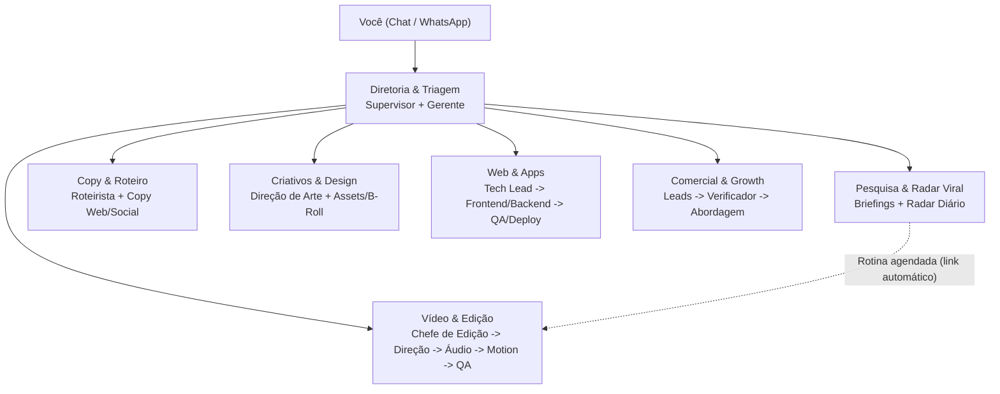

# OpenRoom

**OpenRoom** é uma arquitetura pronta + **skill interativa de entrevista** para você transformar seu [OpenBot](https://openbot.dev) em uma operação multi-agente organizada por setores — como uma empresa/estúdio completo rodando localmente — com equilíbrio de cotas entre contas, regras anti-retrabalho e pipelines automatizados (incluindo **fábrica de vídeos automáticos e clipes virais como GTA 6**).

Em vez de criar dezenas de agentes soltos manualmente e estourar sua cota de IA no primeiro dia, você instala a skill `openroom` no seu agente principal, responde a poucas perguntas guiadas por etapa, e o próprio agente desenha e provisiona toda a estrutura para você.

---

## O que vem no OpenRoom

- **`skills/openroom/`** — Skill interativa (**Modo Entrevista**). O bot principal mapeia seus provedores conectados, faz perguntas curtas em rodadas (setores desejados, orçamento de cota, automações e pastas) e cria agentes, reservas (*fallbacks*), pastas compartilhadas, organograma e rotinas agendadas.
- **`skills/openroom/references/`** — Catálogo modular de setores/agentes, playbook de economia de cotas e arquitetura completa da fábrica de vídeos.
- **`templates/`** — Modelos prontos para copiar e adaptar (`ORGANOGRAMA_E_PROTOCOLO`, `briefing`, `roteiro`, `handoff` entre etapas e perfil de canal de clipes/GTA 6).
- **`TUTORIAL.md`** — Guia completo passo a passo, do zero até a primeira rotina automática rodando.

---

## Visão Geral da Arquitetura



### Pilares do modelo OpenRoom
1. **Separação Advisor vs. Executor vs. QA:** Líderes planejam e revisam; executores fazem o volume pesado; revisores independentes só aprovam com medição real.
2. **Arquivo é a verdade; chat é só aviso:** Toda troca de etapa gera um arquivo versionado (`_v01`, `_v02`, nunca sobrescrito) e um *handoff* curto em log.
3. **Engenharia de Cotas:** Sem `xhigh` como padrão, modelos pesados só em arquitetura/direção, modelos rápidos/gratuitos em triagem e volume, e **fallback cruzado entre contas** (nunca repetir a mesma conta na primeira reserva).
4. **Automação Ponta a Ponta de Vídeos & Clipes Virais:** Pipeline pronto para Shorts/Reels/TikTok — incluindo captação diária agendada (ex.: notícias e clipes de **GTA 6**), corte vertical `1080×1920` a `60 fps`, narração tratada a `-14 LUFS`, motion/legendas e pacote pronto para publicação.

---

## Quickstart (4 passos)

1. **Instale a skill `openroom` no OpenBot**  
   Copie a pasta `skills/openroom` para o seu workspace ou importe como skill local no agente principal (veja os detalhes em [`TUTORIAL.md`](./TUTORIAL.md)).
2. **Inicie a entrevista no chat do seu agente principal:**  
   ```text
   Quero montar minha estrutura no OpenBot usando a skill openroom, com setores, equilíbrio de cotas e pipeline automático para vídeos e clipes de GTA 6. Pode começar as perguntas.
   ```
3. **Responda às 3 rodadas curtas de perguntas** (setores ativos, política de cotas/contas, automações e pastas).
4. **Aprove o plano final** — o agente cria os agentes, configura os modelos reservas, gera o `ORGANOGRAMA_E_PROTOCOLO.md` compartilhado e ativa as rotinas.

---

## Estrutura do Repositório

```text
OpenRoom/
├── README.md
├── TUTORIAL.md
├── LICENSE
├── skills/
│   └── openroom/
│       ├── SKILL.md
│       └── references/
│           ├── sector-catalog.md
│           ├── quota-playbook.md
│           └── video-pipeline-blueprint.md
└── templates/
    ├── ORGANOGRAMA_E_PROTOCOLO.template.md
    └── video/
        ├── briefing.template.md
        ├── handoff.template.md
        ├── perfil-canal-gta6.template.md
        └── roteiro.template.md
```

---

## Privacidade e Segurança

- Nenhum segredo, chave de API, email, ID de conta ou dado pessoal acompanha este repositório.
- O protocolo embutido proíbe agentes de publicar conteúdo, enviar mensagens a terceiros, realizar pagamentos ou excluir arquivos originais sem autorização explícita do usuário.

---

## Licença

Distribuído sob a licença **MIT**. Veja [`LICENSE`](./LICENSE).
